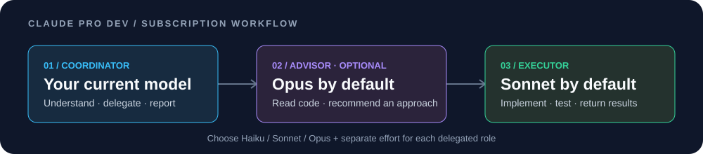

<div align="center">

# Claude Pro Dev

**Choose your coding worker, ask a specialist, and keep track of the session.**

[](https://github.com/googIeuser/Claude-Pro-Dev/actions/workflows/ci.yml)


[](LICENSE)

**English** · [Türkçe](README.tr.md)



[Get started](#get-started) · [Models & reasoning](#models--reasoning) · [Test results](#what-has-actually-been-tested) · [Commands](#local-commands) · [Troubleshooting](#troubleshooting)

</div>

Pro Dev is a Windows plugin for Claude Code. Your current model coordinates the work; an **executor** implements and checks changes, and a read-only **advisor** can help with difficult decisions. Choose Haiku, Sonnet, or Opus and a separate reasoning level for each role. Local commands also show usage, queue tasks, and record checks.

Use your signed-in **Claude subscription**. The plugin requires no separate API key, API server, proxy, npm, Python, or MCP server. Independent community project by [googIeuser](https://github.com/googIeuser).

> [!TIP]
> New here? Install, restart Claude Code **inside your code project**, then try the three-command example below. The default worker is **Sonnet**, and the default advisor is **Opus**.

## Get started

### 1 · In PowerShell: check Claude Code and install

Install [Claude Code](https://code.claude.com/docs/en/setup) first if needed. Check for updates and sign in with your subscription account:

```powershell
claude update
claude --version
claude auth login
```

Claude Code **2.1.293+** is required for Haiku 5.5. The latest version offered by the updater on **2026-10-13** was **2.1.296**, which was used for the live tests below.

Install Pro Dev:

```powershell
irm 'https://raw.githubusercontent.com/googIeuser/Claude-Pro-Dev/main/install.ps1' | iex
```

This downloads and executes the repository's self-contained installer. To inspect the source before running it:

```powershell
git clone https://github.com/googIeuser/Claude-Pro-Dev.git
Set-Location .\Claude-Pro-Dev
powershell.exe -NoProfile -ExecutionPolicy Bypass -File .\install.ps1
```

Administrator access is unnecessary. To update Pro Dev later, run the installer again using a fresh download or updated checkout.

### 2 · In your project: start a fresh Claude Code session

Open the folder containing the code you want to change, then start `claude`. If a session was already running during installation, close it and start a new one. Inside Claude Code, check `/plugin`, then `/prodev`.

> [!IMPORTANT]
> Installation saves **manual compaction**: automatic compaction is disabled, so use `/compact` when needed. Settings and the old package are backed up. The optional teams flag is preserved unless you explicitly enable it. [See all installation changes](#installation-settings--removal).

### 3 · Inside Claude Code: choose roles and give a complete task

```text
/prodev-model executor sonnet medium
/prodev-model advisor opus high
/prodev:advisor Fix the parser so negative integers keep their sign. Ask the advisor about the approach, delegate the fix to the executor, and run the parser tests.
```

The first two commands save choices locally without starting a model turn. The third starts the model workflow. Describe the affected behavior and expected result; a bare number such as `31` does not identify a repository issue or task by itself.

## How the workflow works

| Role | Responsibility | Default |
| --- | --- | --- |
| Your main session | Understands the request, delegates, and reports the result. | Your current model |
| `prodev:advisor` | Reads relevant code and recommends an approach; cannot edit or run shell commands. | Opus |
| `prodev:executor` | Implements the assigned change and verifies it. | Sonnet |

Use **`/prodev:advisor <task>`** for difficult bugs or changes that benefit from a second opinion. The advisor is optional for obvious tasks and may be consulted again for a blocker or difficult review. Your main session keeps its model; role choices apply to delegated agents.

This adapts Anthropic's [advisor pattern](https://platform.claude.com/docs/en/agents-and-tools/tool-use/advisor-tool) using [Claude Code subagents](https://code.claude.com/docs/en/sub-agents). The platform Advisor Tool itself is an API feature. Pro Dev implements the pattern through Claude Code agents and your signed-in session. The advisor receives the supplied context and relevant files, rather than an automatic copy of the full conversation.

For ordinary development, you can still write a normal prompt. Pro Dev supplies short engineering guidance; `/prodev:engineering` is also available as an optional checklist.

## Models & reasoning

### Pick a model, or let the workflow choose

| Goal | Command inside Claude Code |
| --- | --- |
| Give a narrow, well-defined task to Haiku | `/prodev-model executor haiku low` |
| Use Sonnet for implementation | `/prodev-model executor sonnet medium` |
| Ask Opus for deeper advice | `/prodev-model advisor opus high` |
| Let the workflow choose Haiku or Sonnet per assignment | `/prodev-model executor auto medium` |
| Follow the parent model and effort | `/prodev-model executor inherit inherit` |
| Show current choices | `/prodev-model` |
| Restore Sonnet worker / Opus advisor defaults | `/prodev-model reset` |

`auto` gives the workflow this guidance: choose **Haiku for narrow, clearly specified work** and **Sonnet for complex, ambiguous, or multi-file work**. It announces the choice before delegation. This is prompt guidance, rather than a deterministic classifier or quota optimizer.

Both roles accept `haiku`, `sonnet`, `opus`, `inherit`, or the exact IDs `claude-haiku-5-5`, `claude-sonnet-5-5`, `claude-opus-5-5`. Aliases follow Claude Code's resolution; an exact ID requests that version. `auto` is available only for the executor.

### Set each role's reasoning effort

Available values: **`low` · `medium` · `high` · `xhigh` · `max` · `inherit`**.

Start with `medium` for implementation and `high` for a difficult advisory question, then adjust to the task. Higher effort can use more allowance and time. The same label does not mean equal thinking across models. An omitted effort resets that role to `inherit`, which follows the caller/host setting.

> [!NOTE]
> Choices are **session-only** and apply to **new Pro Dev agents**. Existing agents retain their settings; other agents and your global model settings are unaffected. Reloading/exiting clears the choices. Use native `/model` and `/effort` to change your main session.

Inspect worker details in `/tasks`. Model availability, host policy, environment overrides, and capability limits can take precedence. The 5.5 models use adaptive reasoning; this plugin provides no supported per-agent thinking-off switch. [Official model configuration](https://code.claude.com/docs/en/model-config).

## What has actually been tested?

**Recorded on 2026-10-13 · Pro Dev 0.3.1 · local Claude Code 2.1.296 · Windows.**

| Status | Test | Observed result |
| --- | --- | --- |
| 🟢 Passed | Claude Code updater | Installed 2.1.296 was already up to date. |
| 🟢 Passed | Native plugin tests | **55 passed, 0 failed**; includes model choices, effort forwarding, filtering, queue, and receipts. |
| 🟢 Passed | Real CLI helper smoke | **20 helper results, 0 model turns**; nine helpers and both role/workflow definitions discovered. |
| 🟢 Passed | Live Haiku executor | Haiku 5.5 with requested `low` effort returned **323** for the small arithmetic task. |
| 🟢 Passed | Live Sonnet advisor + executor | Separate requested `high` / `medium` effort; arithmetic result **437**. |
| 🟢 Passed | Live `auto` selection | Selected Haiku for a narrow arithmetic task; result **91**. |
| 🟢 Passed | **Live Opus advisor + Sonnet coding worker** | Fixed a signed-integer parser bug. **6 independent acceptance cases passed**; the original bug failed beforehand, and the supplied check file stayed unchanged. |
| 🟢 Passed | Installer & release checks | Isolated installation, upgrade, rollback, packaging integrity, and reproducibility checked in PowerShell **5.1 and 7**. |
| 🟡 Not live-tested | Native interactive Agent Teams | Workflow/role discovery and teams configuration were checked; actual teammate coordination was not exercised. |
| ⚪ Not measured | Savings, general code quality, effective reasoning budget | No conclusion from these small tests. |

Actual live model IDs were reported by Claude Code. Effort evidence is the **requested Agent invocation arguments**; provider reasoning budgets were not measured. The coding result is one isolated bugfix, not a general coding benchmark. A failed initial calibration is recorded separately from the passing arithmetic cases.

[Detailed verification](docs/VERIFICATION.md) · [Arithmetic evidence](docs/live-model-smoke.json) · [Coding evidence](docs/live-coding-smoke.json) · [CI matrix: 2.1.293 / 2.1.296 × two shells](https://github.com/googIeuser/Claude-Pro-Dev/actions/workflows/ci.yml)

## Optional: Agent Teams

Use **`/prodev:team <task>`** when work can be divided across independent files or modules. A small team is the default. Keep sequential work or changes to the same file in one session.

Enable teams **before starting an interactive session**. From the downloaded repository, the installer can save the setting:

```powershell
powershell.exe -NoProfile -ExecutionPolicy Bypass -File .\install.ps1 -EnableAgentTeams
```

Or enable it only in the current PowerShell environment:

```powershell
$env:CLAUDE_CODE_EXPERIMENTAL_AGENT_TEAMS = '1'
claude
```

Then, inside Claude Code:

```text
/prodev-model executor sonnet medium
/prodev:team Improve the settings screen and its tests. Assign separate files to two teammates, share findings, and verify the combined changes.
```

> [!WARNING]
> Teams are **experimental and not live-tested in this release**. They need an interactive session and are unavailable in `claude -p`. Windows' in-process display needs no tmux. Prefer in-process teams for individual effort control; split-pane behavior depends on the host.

Claude Code manages native team creation, messages, and tasks; Pro Dev supplies the workflow and roles. If teams or a requested model are unavailable, the workflow must say so and identify any fallback. Ordinary subagents do not constitute a native team. [Official team controls and limitations](https://code.claude.com/docs/en/agent-teams).

**Agent workflows consume your subscription allowance.** Extra coordination and agents can increase usage and latency. Pro Dev does not unlock models, increase limits, or guarantee savings.

## Local commands

These **nine helpers do not start a model turn**. Run them inside Claude Code. `/prodev:advisor`, `/prodev:team`, and other model skills are separate from these helpers.

| Command | What it does |
| --- | --- |
| `/prodev` | Shows usage, counters, and the command overview. |
| `/prodev-doctor` | Checks loaded hooks, conflicts, and missing readings. |
| `/prodev-model [executor\|advisor <model> [effort] \| reset]` | Shows or changes choices for future Pro Dev agents. |
| `/prodev-queue add <task>` | Saves a task without starting it. |
| `/prodev-flow [mermaid]` | Displays observed agent activity; does not manage a team. |
| `/prodev-next` | Suggests simple next steps. |
| `/prodev-checks [profile \| run <name>]` | Shows verification receipts or runs a selected project check. |
| `/prodev-report` | Exports session metrics JSON without prompt/tool bodies. |
| `/prodev-filter on` / `off` | Toggles shortening of long shell/MCP output; redaction remains active. |

Queue management: `/prodev-queue list`, `draft <id>`, `remove <id>`, `clear`. `draft` fills the prompt; press Enter to send it. Queues, choices, receipts, and counters disappear when the session ends.

The 5-hour and 7-day readings come from Claude Code; unavailable data displays **`unknown`**. Context fill and cache ratio measure different things and are not remaining allowance.

For project checks, copy [the example](docs/prodev.example.json) to `.prodev.json` in your working folder and review the programs. Nothing runs automatically. `/prodev-checks run <name>` executes the selected program as your Windows user. [Checks and receipt limits](docs/PROJECT-CHECKS.md).

## Troubleshooting

| Symptom | What to do |
| --- | --- |
| `/prodev:advisor` is “not installed” | Update Pro Dev with the installer, restart Claude Code, and check `/plugin` then `/prodev-doctor`. Updating Claude Code alone does not update Pro Dev. |
| A slash command fails in PowerShell | Run installation commands in PowerShell; run `/prodev…` commands inside Claude Code. Helpers use a hyphen; workflows use a colon. |
| Claude cannot find code or a task | Start in the actual project folder and give a complete task or repository/issue reference. |
| Model or effort unavailable | Update Claude Code and check your account's available models. Report the limitation; choose an available model explicitly. |
| Usage says `unknown` | The host did not supply that reading. `/prodev-doctor` can show missing telemetry. |
| Output seems incomplete | Use targeted output or `/prodev-filter off`; shortening can omit useful evidence. |
| Teams do not start | Enable the flag, start a new interactive session, and check the official experimental feature limitations. |

## Installation settings & removal

<details>
<summary><strong>See what the installer changes and how to undo it</strong></summary>

- Registers `prodev@claude-pro-dev-local` in user scope, under `%USERPROFILE%\.claude\prodev\package` or your existing `CLAUDE_CONFIG_DIR`.
- Backs up configuration and the previous package; restores them if installation fails.
- Disables automatic compaction and removes the old custom threshold. Use `/compact` manually.
- Preserves model, effort, permissions, environment settings, and project instructions. `-EnableAgentTeams` explicitly enables the teams flag.
- Disables overlapping user-scope `prodev` plugins from other marketplaces to avoid duplicate commands; retains their files.

Version 0.3 removes the command/file-name guard and `/prodev-guard`; Pro Dev no longer rejects tool calls by keyword. Claude Code's permissions still apply. Best-effort output redaction remains, but cannot ensure complete secret protection.

```powershell
claude plugin disable prodev@claude-pro-dev-local --scope user
claude plugin uninstall prodev@claude-pro-dev-local --scope user
```

Saved compaction and teams preferences remain after removal. Restore a backup or edit `settings.json`: set `autoCompactEnabled` to `true` for automatic compaction, and remove the teams environment entry to disable teams in new sessions. Clear any shell-level teams flag too. Backups remain under `.claude\prodev\backups`.

</details>

## Development & further reading

<details>
<summary><strong>Run validation and build the self-contained installer</strong></summary>

```powershell
claude plugin validate . --strict
claude plugin validate .\plugins\prodev --strict
claude plugin test .\plugins\prodev
powershell.exe -NoProfile -File .\tests\metrics.Tests.ps1
powershell.exe -NoProfile -File .\scripts\build-release.ps1
powershell.exe -NoProfile -File .\tests\release.Tests.ps1
powershell.exe -NoProfile -File .\tests\install.Tests.ps1
```

Rebuild root `install.ps1` after changing embedded files, including the README and docs. Native tests need no model credentials; live model tests require sign-in and consume allowance. Static validation cannot prove live team behavior.

</details>

[Architecture](docs/ARCHITECTURE.md) · [Verification](docs/VERIFICATION.md) · [Benchmark protocol](docs/BENCHMARK.md) · [Contributing](CONTRIBUTING.md) · [Publishing](docs/PUBLISHING.md) · [MIT license](LICENSE)

Older pilot files are historical v0.2 evidence and do not establish results or savings for the current workflows.
