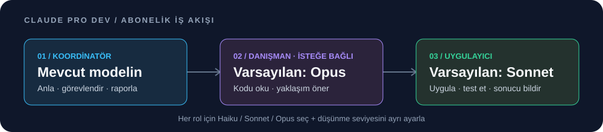

<div align="center">

# Claude Pro Dev

**Kod yazan modeli seç, uzmana danış, oturumunu takip et.**

[](https://github.com/googIeuser/Claude-Pro-Dev/actions/workflows/ci.yml)


[](LICENSE)

[English](README.md) · **Türkçe**



[Hızlı başlangıç](#hızlı-başlangıç) · [Model ve düşünme](#model-ve-düşünme) · [Test sonuçları](#gerçekte-neler-test-edildi) · [Komutlar](#yerel-komutlar) · [Sorun giderme](#sorun-giderme)

</div>

Pro Dev, Claude Code için bir Windows eklentisidir. Mevcut modelin işi koordine eder; **uygulayıcı (executor)** kodu değiştirip kontrol eder, yalnızca okuma yetkili **danışman (advisor)** ise zor kararlarda yardımcı olur. Her rol için Haiku, Sonnet veya Opus seçebilir, düşünme seviyesini ayrı ayarlayabilirsin. Yerel komutlarla kullanımını görebilir, görevleri sıraya koyabilir ve yapılan kontrolleri takip edebilirsin.

Giriş yaptığın **Claude aboneliğini** kullanır. Ayrı API anahtarı, API sunucusu, proxy, npm, Python veya MCP sunucusu gerektirmez. [googIeuser](https://github.com/googIeuser) tarafından geliştirilen bağımsız bir topluluk projesidir.

> [!TIP]
> İlk kullanım: kur ve Claude Code'u **kod projenin klasöründe yeniden başlat**. Varsayılan ana model **Opus 5.5**, uygulayıcı **Sonnet 5.5**, danışman **Opus 5.5**; **üçünün eforu da medium**. Uygulayıcı için Haiku 5.5 seçilebilir.

## Hızlı başlangıç

### 1 · PowerShell'de: Claude Code'u kontrol et ve eklentiyi kur

Gerekirse önce [Claude Code'u kur](https://code.claude.com/docs/en/setup). Güncellemeyi kontrol et ve abonelik hesabınla giriş yap:

```powershell
claude update
claude --version
claude auth login
```

Haiku 5.5 için Claude Code **2.1.293+** gerekir. **13 Ekim 2026** tarihinde güncelleyicinin sunduğu güncel sürüm **2.1.296** idi; aşağıdaki canlı testler bu sürümde yapıldı.

Pro Dev'i kur:

```powershell
irm 'https://raw.githubusercontent.com/googIeuser/Claude-Pro-Dev/main/install.ps1' | iex
```

Bu komut repodaki bağımsız kurulum dosyasını indirip çalıştırır. Önce kaynağı incelemek istersen:

```powershell
git clone https://github.com/googIeuser/Claude-Pro-Dev.git
Set-Location .\Claude-Pro-Dev
powershell.exe -NoProfile -ExecutionPolicy Bypass -File .\install.ps1
```

Yönetici yetkisi gerekmez. Pro Dev'i daha sonra güncellemek için kurulum dosyasını yeniden indir veya yerel repoyu güncelleyip kurulumu tekrar çalıştır.

### 2 · Projende: yeni bir Claude Code oturumu aç

Değiştireceğin kodun bulunduğu klasörü aç, ardından `claude` çalıştır. Kurulum sırasında açık olan oturumu kapatıp yenisini aç. Claude Code içinde önce `/plugin`, sonra `/prodev` ile kontrol et.

> [!IMPORTANT]
> Kurulum **elle sıkıştırma** tercihini kaydeder: otomatik bağlam sıkıştırma kapanır; gerektiğinde `/compact` kullan. Ayarlar ve eski paket yedeklenir. İsteğe bağlı ekip ayarı, açıkça etkinleştirmediğin sürece korunur. [Tüm kurulum değişiklikleri](#kurulum-ayarları-ve-kaldırma).

### 3 · Claude Code içinde: varsayılanlarla başla

```text
/prodev-model
/prodev:advisor Ayrıştırıcıdaki negatif sayıların işaretini kaybetme hatasını düzelt. Yaklaşım için danışmana sor, düzeltmeyi uygulayıcıya devret ve ayrıştırıcı testlerini çalıştır.
```

İlk komut model turu başlatmadan rol seçimlerini gösterir. İkincisi iş akışını başlatır; yeni kurulumda ayrıca model ayarlaman gerekmez. Hatalı davranışı ve beklediğin sonucu belirt; tek başına `31` yazmak hangi repo issue'sunu veya görevi kastettiğini açıklamaz.

## İş akışı nasıl çalışır?

| Rol | Görevi | Varsayılan model | Efor |
| --- | --- | --- | --- |
| Ana oturumun | İsteği anlar, işi dağıtır ve sonucu bildirir. | **Opus 5.5** | **medium** |
| `prodev:advisor` | İlgili kodu okuyup yaklaşım önerir; dosya değiştiremez, terminal komutu çalıştıramaz. | **Opus 5.5** | **medium** |
| `prodev:executor` | Kendisine verilen değişikliği uygular ve doğrular. | **Sonnet 5.5**; Haiku 5.5 seçilebilir | **medium** |

Yeni kurulum ana modeli ve model başına efor varsayılanlarını kaydeder. Normal yeniden kurulum, değiştirdiğin kişisel tercihleri korur. Mevcut kurulumuna bu varsayılanları uygulamak için indirdiğin dosyayı `-ResetModelDefaults` ile çalıştır. Proje, yönetim, ortam veya başlatma ayarları öncelikli olabilir.

```powershell
powershell.exe -NoProfile -ExecutionPolicy Bypass -File .\install.ps1 -ResetModelDefaults
```

İkinci görüşün yararlı olacağı zor hata ve değişikliklerde **`/prodev:advisor <görev>`** kullan. Basit işlerde danışmana başvurmak şart değildir; bir engelde veya zor son kontrolde tekrar danışılabilir. Ana oturumunun modeli korunur; rol seçimleri devredilen ajanlara uygulanır.

Bu akış, Anthropic'in [advisor yaklaşımını](https://platform.claude.com/docs/en/agents-and-tools/tool-use/advisor-tool) [Claude Code alt ajanlarıyla](https://code.claude.com/docs/en/sub-agents) uyarlar. Platformdaki Advisor Tool bir API özelliğidir. Pro Dev aynı yaklaşımı Claude Code ajanları ve giriş yaptığın oturum üzerinden uygular. Danışmana verilen bağlam ve ilgili dosyalar aktarılır; tüm konuşmanın otomatik kopyası aktarılmaz.

Normal geliştirme için düz bir istek yazmaya devam edebilirsin. Pro Dev kısa mühendislik yönergeleri sağlar; istersen `/prodev:engineering` kontrol listesini de kullanabilirsin.

## Model ve düşünme

### Modeli sen seç veya iş akışına seçtir

| Amaç | Claude Code içindeki komut |
| --- | --- |
| Dar kapsamlı, net işi Haiku'ya ver | `/prodev-model executor haiku low` |
| Tam Haiku 5.5 sürümünü medium eforla kullan | `/prodev-model executor claude-haiku-5-5 medium` |
| Uygulama için Sonnet kullan | `/prodev-model executor sonnet medium` |
| Opus'tan daha derin görüş al | `/prodev-model advisor opus high` |
| Her görev için Haiku/Sonnet seçimini akışa bırak | `/prodev-model executor auto medium` |
| Üst ajanın modelini ve düşünme ayarını izle | `/prodev-model executor inherit inherit` |
| Mevcut seçimleri gör | `/prodev-model` |
| Sonnet uygulayıcı / Opus danışman varsayılanlarına dön | `/prodev-model reset` |

`auto`, iş akışına şu yönergeyi verir: **dar kapsamlı ve net işlerde Haiku**, **karmaşık, belirsiz veya birden fazla dosyaya yayılan işlerde Sonnet** seç. Seçim, işi devretmeden önce açıklanır. Bu, bir prompt yönergesidir; kesin kurallı sınıflandırıcı veya kota optimizasyon sistemi değildir.

İki rol de `haiku`, `sonnet`, `opus`, `inherit` veya tam sürüm kimliklerini kabul eder: `claude-haiku-5-5`, `claude-sonnet-5-5`, `claude-opus-5-5`. Kısa adları Claude Code çözümler; tam kimlik belirli sürümü talep eder. `auto` yalnızca uygulayıcı için kullanılabilir.

### Her rolün düşünme seviyesini ayrı ayarla

Seçenekler: **`low` · `medium` · `high` · `xhigh` · `max` · `inherit`**.

Üç rol de **medium** ile başlar. Yüksek seviye daha fazla kullanım hakkı ve zaman harcayabilir; aynı seviye adı farklı modellerde aynı düşünme miktarı demek değildir. Model komutunda efor yazmazsan **medium** kullanılır. Çağıran ajanın/Claude Code'un efor ayarını korumak için açıkça `inherit` seç.

Ana oturumunu `/model` ve `/effort` ile değiştir. `/prodev-model reset`, bu oturumdaki yeni rol ajanlarını **Sonnet 5.5 / Opus 5.5 + medium** ayarına döndürür; ana modeli sıfırlamaz. Kısa model adları kullanılabilir; varsayılanlar tam 5.5 sürüm kimliklerine sabitlenmiştir.

> [!NOTE]
> Seçimler **yalnızca bu oturumdaki yeni Pro Dev ajanlarına** uygulanır. Açılmış ajanlar ayarlarını korur; diğer ajanlar ve genel model ayarların etkilenmez. Yeniden yükleme/çıkış seçimleri sıfırlar. Ana oturumunu değiştirmek için yerleşik `/model` ve `/effort` komutlarını kullan.

Ajan ayrıntılarını `/tasks` içinde kontrol et. Hesabındaki model erişimi, Claude Code politikaları, ortam değişkenleri ve modelin desteklediği özellikler öncelikli olabilir. 5.5 modelleri uyarlanabilir düşünme kullanır; burada ajan başına düşünmeyi tamamen kapatan destekli bir seçenek yoktur. [Resmî model ayarları](https://code.claude.com/docs/en/model-config).

## Gereksiz bağlamı azaltma

**0.3.2** sürümünde terminal stdout/stderr ve MCP metin parçaları **her sonuç için ortak 12.000 karakter sınırı** kullanır. Hata içeren çıktı/parçalara öncelik verilir; atlanan içerik belirtilir, görseller, yapılandırılmış veriler ve çıkış bilgileri korunur. Küçük sonuçlar değişmez. `/prodev-filter off` tam metni geri getirir; maskeleme açık kalır. Sınır, görünür metne uygulanır; tüm yapılandırılmış veriye veya token sayısına uygulanmaz.

0.3.2 ölçümlerinde oturum seçimlerine eklenen tekrar yönergelerin kaldırılması da incelendi. Aynı yapay örneklerde MCP metni **60.355 → 11.491**, terminal metni **19.849 → 4.022**, Pro Dev çekirdeği + danışman skill'i + seçim metni **5.013 → 4.398 karaktere** indi. Kontrol edilen hata ayrıntıları korundu. Bunlar **karakter azalmasıdır; ölçülmüş abonelik tasarrufu değildir**. [Ölçümler ve tekrarlama adımları](docs/OPTIMIZATION.md).

Claude Code içinde daha hafif bir başlangıç ayarı:

```text
/prodev-model executor auto low
/prodev-model advisor sonnet medium
```

Bu seçimler ana modelini değiştirmez. Küçük düzeltmede normal istek yaz; danışmanı ikinci görüş gerektiğinde, ekipleri bağımsız işlere ayırabildiğinde kullan. Görev gerektirdiğinde düşünme seviyesini yükselt veya daha güçlü model seç. `auto` hâlâ iş akışı yönergesidir ve her ajan kullanım hakkını harcar. 0.3.2 metin optimizasyonu modelleri veya hesap limitlerini değiştirmedi; 0.3.3, yukarıdaki değiştirilebilir varsayılanları ekler.

## Gerçekte neler test edildi?

**Kayıt: 13 Ekim 2026 · Pro Dev 0.3.3 · yerel Claude Code 2.1.296 · Windows.**

Aşağıdaki eklenti/yardımcı komut/kurulum kontrolleri 0.3.3 için tekrarlandı. Aritmetik ve önceki kod satırları, belirtilen sürümlerin tarihsel kanıtlarıdır. Güncel varsayılan profilin kod testi ayrıca kaydedildi.

| Durum | Test | Gözlenen sonuç |
| --- | --- | --- |
| 🟢 Geçti | Claude Code güncelleyicisi | Kurulu 2.1.296 zaten günceldi. |
| 🟢 Geçti | Yerel eklenti testleri | **64 başarılı, 0 başarısız**; model seçimi, düşünme aktarımı, filtreleme, kuyruk ve kontrol kayıtları dahil. |
| 🟢 Geçti | Gerçek CLI yardımcı komut denemesi | **20 komut sonucu, 0 model turu**; dokuz yardımcı komut ve iki rol/iş akışı bulundu. |
| 🟢 Geçti | **0.3.3 kurulu varsayılan profil** | Ana model Opus 5.5, `/effort status` medium; danışman Opus / uygulayıcı Sonnet talepleri medium. **6 bağımsız kod kontrolü geçti**. Bir araç isteği reddi ayrıca kaydedildi. [Kanıt](docs/live-coding-smoke.v0.3.3.json). |
| 🟢 Geçti | Ortak metin sınırı | Çok parçalı MCP ve birleşik terminal metni 12.000 karakter içinde kaldı; denenen geç hata ayrıntıları, metadata, filtre kapatma ve küçük sonuç davranışı korundu. |
| 🟢 Geçti | **0.3.2 canlı Sonnet danışman + Haiku uygulayıcı** | `medium` / `low` düşünme talepleriyle işaretli sayı hatası düzeltildi; **6 bağımsız kabul kontrolü geçti**. [Kanıt](docs/live-coding-smoke.v0.3.2.json). |
| 🟢 Geçti | Canlı Haiku uygulayıcı | `low` düşünme talep edilen Haiku 5.5, küçük aritmetik görevinde **323** sonucunu verdi. |
| 🟢 Geçti | Canlı Sonnet danışman + uygulayıcı | Ayrı `high` / `medium` düşünme talepleriyle aritmetik sonucu **437**. |
| 🟢 Geçti | Canlı `auto` seçimi | Dar kapsamlı aritmetik işinde Haiku seçildi; sonuç **91**. |
| 🟢 Geçti | **Canlı Opus danışman + Sonnet kod uygulayıcı** | İşaretli tam sayı ayrıştırma hatasını düzeltti. **6 bağımsız kabul kontrolü geçti**; ilk hatalı sürüm önceden başarısız oldu, verilen kontrol dosyası değiştirilmedi. |
| 🟢 Geçti | Kurulum ve paket kontrolleri | Ayrı ortamda kurulum, yükseltme, geri alma, paket bütünlüğü ve yeniden üretilebilirlik PowerShell **5.1 ve 7** ile kontrol edildi. |
| 🟡 Canlı denenmedi | Yerel etkileşimli Agent Teams | Rol/iş akışının yüklenmesi ve ekip ayarı kontrol edildi; gerçek ekip koordinasyonu çalıştırılmadı. |
| ⚪ Ölçülmedi | Tasarruf, genel kod kalitesi, gerçek düşünme bütçesi | Bu küçük testlerden böyle bir sonuç çıkarılmıyor. |

Canlı model kimliklerini Claude Code raporladı. Düşünme kanıtı, **Agent çağrısında istenen ayarlardır**; sağlayıcının gerçek düşünme bütçesi ölçülmedi. Kod sonucu, ayrı klasörde yapılan tek bir hata düzeltmesidir; genel kodlama kıyaslaması değildir. Başarısız ilk kalibrasyon, geçen aritmetik denemelerinden ayrı kaydedildi.

[Ayrıntılı doğrulama](docs/VERIFICATION.md) · [Aritmetik kanıtları](docs/live-model-smoke.json) · [Kod düzeltme kanıtı](docs/live-coding-smoke.json) · [CI matrisi: 2.1.293 / 2.1.296 × iki PowerShell](https://github.com/googIeuser/Claude-Pro-Dev/actions/workflows/ci.yml)

## İsteğe bağlı: Agent Teams

İş bağımsız dosyalara veya modüllere ayrılabiliyorsa **`/prodev:team <görev>`** kullan. Varsayılan ekip küçüktür. Sırayla yapılacak veya aynı dosyayı değiştiren işleri tek oturumda tut.

Ekipleri **etkileşimli oturumu başlatmadan önce** aç. İndirdiğin repo klasöründe kurulum dosyası bu ayarı kaydedebilir:

```powershell
powershell.exe -NoProfile -ExecutionPolicy Bypass -File .\install.ps1 -EnableAgentTeams
```

Veya yalnızca mevcut PowerShell ortamında etkinleştir:

```powershell
$env:CLAUDE_CODE_EXPERIMENTAL_AGENT_TEAMS = '1'
claude
```

Ardından Claude Code içinde:

```text
/prodev-model executor sonnet medium
/prodev:team Ayarlar ekranını ve testlerini geliştir. İki ekip arkadaşına ayrı dosyalar ver, bulguları paylaş ve birleşik değişiklikleri doğrula.
```

> [!WARNING]
> Ekipler **deneyseldir ve bu sürümde canlı test edilmemiştir**. Etkileşimli oturum gerekir; `claude -p` modunda kullanılamaz. Windows'ta aynı oturum içindeki görünüm tmux gerektirmez. Ajan başına düşünme ayarı için bu görünümü tercih et; bölünmüş terminal davranışı ortama bağlıdır.

Yerel ekip kurma, mesaj ve görev yönetimini Claude Code yapar; Pro Dev iş akışını ve rolleri sağlar. Ekipler veya istenen model kullanılamıyorsa akış bunu açıklamalı, başvurulan alternatifi belirtmelidir. Normal alt ajanlar yerel Agent Teams ekibi sayılmaz. [Resmî ekip kontrolleri ve sınırlamalar](https://code.claude.com/docs/en/agent-teams).

**Ajanlı iş akışları abonelik kullanım hakkını harcar.** Ek koordinasyon ve ajanlar kullanımı ve bekleme süresini artırabilir. Pro Dev model erişimi açmaz, limit yükseltmez veya tasarruf garantisi vermez.

## Yerel komutlar

Bu **dokuz yardımcı komut model turu başlatmaz**. Claude Code içinde çalıştırılır. `/prodev:advisor`, `/prodev:team` ve model kullanan diğer skill'ler bu yardımcı komutlardan ayrıdır.

| Komut | Ne yapar? |
| --- | --- |
| `/prodev` | Kullanımı, sayaçları ve komut özetini gösterir. |
| `/prodev-doctor` | Yüklenen hook'ları, çakışmaları ve eksik ölçümleri kontrol eder. |
| `/prodev-model [executor\|advisor <model> [effort] \| reset]` | Yeni Pro Dev ajanlarının seçimlerini gösterir veya değiştirir. |
| `/prodev-queue add <görev>` | Görevi başlatmadan kaydeder. |
| `/prodev-flow [mermaid]` | Gözlenen ajan hareketlerini gösterir; ekip yönetmez. |
| `/prodev-next` | Basit sonraki adım önerileri verir. |
| `/prodev-checks [profile \| run <ad>]` | Kontrol kayıtlarını gösterir veya seçilen proje kontrolünü çalıştırır. |
| `/prodev-report` | Prompt/araç gövdeleri olmadan oturum ölçümlerini JSON olarak dışa verir. |
| `/prodev-filter on` / `off` | Uzun terminal/MCP çıktılarının kısaltılmasını açar/kapatır; maskeleme açık kalır. |

Kuyruk yönetimi: `/prodev-queue list`, `draft <id>`, `remove <id>`, `clear`. `draft` prompt alanını doldurur; göndermek için Enter'a bas. Kuyruk, seçimler, kontrol kayıtları ve sayaçlar oturum sonunda silinir.

5 saatlik ve 7 günlük kullanım ölçümleri Claude Code'dan gelir; veri yoksa **`unknown`** gösterilir. Bağlam doluluğu ve önbellek oranı farklı ölçümlerdir; kalan kullanım hakkını göstermezler.

Proje kontrolleri için [örneği](docs/prodev.example.json) çalışma klasöründe `.prodev.json` olarak kopyala ve programları incele. Otomatik çalıştırma yoktur. `/prodev-checks run <ad>` seçilen programı Windows kullanıcın olarak çalıştırır. [Kontroller ve kayıt sınırları](docs/PROJECT-CHECKS.md).

## Sorun giderme

| Belirti | Yapılacak işlem |
| --- | --- |
| `/prodev:advisor` “yüklü değil” diyor | Pro Dev'i kurulum dosyasıyla güncelle, Claude Code'u yeniden başlat, `/plugin` ve `/prodev-doctor` ile kontrol et. Sadece Claude Code'u güncellemek Pro Dev'i güncellemez. |
| PowerShell'de slash komutu çalışmıyor | Kurulum komutları PowerShell'de; `/prodev…` komutları Claude Code içinde çalışır. Yardımcılar tire, iş akışları iki nokta kullanır. |
| Claude kodu veya görevi bulamıyor | Gerçek proje klasöründe başlat; açık bir görev veya repo/issue bilgisi ver. |
| Model veya düşünme seviyesi kullanılamıyor | Claude Code'u güncelle, hesabındaki model erişimini kontrol et. Sınırlamayı belirt ve erişilebilir modeli açıkça seç. |
| Kullanım `unknown` görünüyor | Claude Code o ölçümü sağlamamış. `/prodev-doctor` eksik veriyi gösterebilir. |
| Çıktı eksik görünüyor | Daha hedefli çıktı iste veya `/prodev-filter off` kullan; kısaltma yararlı kanıtı gizleyebilir. |
| Ekip başlamıyor | Ayarı aç, yeni etkileşimli oturum başlat ve deneysel özelliğin resmî sınırlarını kontrol et. |

## Kurulum ayarları ve kaldırma

<details>
<summary><strong>Kurulumun değiştirdikleri ve geri alma adımları</strong></summary>

- `prodev@claude-pro-dev-local` eklentisini kullanıcı kapsamında, `%USERPROFILE%\.claude\prodev\package` veya mevcut `CLAUDE_CONFIG_DIR` altında kaydeder.
- Ayarları ve önceki paketi yedekler; kurulum başarısız olursa geri yükler.
- Otomatik sıkıştırmayı kapatır ve eski özel eşiği kaldırır. Gerektiğinde `/compact` kullan.
- Eksik varsayılanları ekler: ana model Opus 5.5 ve Opus/Sonnet/Haiku 5.5 için medium efor. Mevcut model/efor seçimleri yalnızca `-ResetModelDefaults` seçilirse sıfırlanır. İzinler, diğer ortam ayarları ve proje yönergeleri korunur. `-EnableAgentTeams` ekip ayarını açıkça etkinleştirir.
- Çift komut oluşmaması için başka marketplace'lerdeki çakışan kullanıcı kapsamlı `prodev` eklentilerini devre dışı bırakır; dosyalarını saklar.

0.3 sürümünde komut/dosya adı guard'ı ve `/prodev-guard` kaldırıldı; Pro Dev anahtar kelime yüzünden araç çağrılarını reddetmez. Claude Code'un izinleri uygulanmaya devam eder. Çıktıda mümkün olduğunca maskeleme yapılır; bu, tüm sırların korunacağını garanti etmez.

```powershell
claude plugin disable prodev@claude-pro-dev-local --scope user
claude plugin uninstall prodev@claude-pro-dev-local --scope user
```

Kaldırma sonrasında model/efor, sıkıştırma ve ekip tercihleri kalır. Model profilini `/model` ve `/effort` ile değiştir veya yedeği geri yükle. Yedeği geri yükle veya `settings.json` içinde otomatik sıkıştırma için `autoCompactEnabled` değerini `true` yap; yeni oturumlarda ekipleri kapatmak için ilgili ortam girdisini kaldır. PowerShell'de tanımlanmış ekip değişkenini de temizle. Yedekler `.claude\prodev\backups` altında kalır.

</details>

## Geliştirme ve ek belgeler

Topluluk: [Katkı rehberi](CONTRIBUTING.md#türkçe) · [Davranış kuralları](CODE_OF_CONDUCT.md#türkçe) · [Destek](SUPPORT.md#türkçe) · [Güvenlik politikası](SECURITY.md#türkçe) · [Issue formları](https://github.com/googIeuser/Claude-Pro-Dev/issues/new/choose). Türkçe ve İngilizce kullanılabilir. Güvenlik açıklarını herkese açık issue yerine özel kanaldan bildir.

<details>
<summary><strong>Doğrulama komutları ve bağımsız kurulum dosyası üretimi</strong></summary>

```powershell
claude plugin validate . --strict
claude plugin validate .\plugins\prodev --strict
claude plugin test .\plugins\prodev
powershell.exe -NoProfile -File .\tests\metrics.Tests.ps1
powershell.exe -NoProfile -File .\scripts\build-release.ps1
powershell.exe -NoProfile -File .\tests\release.Tests.ps1
powershell.exe -NoProfile -File .\tests\install.Tests.ps1
```

README ve belgeler dahil gömülü dosyalar değiştiğinde kökteki `install.ps1` dosyasını yeniden üret. Yerel eklenti testleri model girişi gerektirmez; canlı model testleri giriş ister ve kullanım hakkı harcar. Statik doğrulama, canlı ekip davranışını kanıtlamaz.

</details>

[Mimari](docs/ARCHITECTURE.md) · [Doğrulama](docs/VERIFICATION.md) · [Kıyaslama protokolü](docs/BENCHMARK.md) · [Katkı rehberi](CONTRIBUTING.md) · [Yayınlama](docs/PUBLISHING.md) · [MIT lisansı](LICENSE)

Eski pilot dosyaları v0.2'nin tarihsel kanıtlarıdır; güncel iş akışlarının başarısını veya tasarrufunu kanıtlamazlar.
